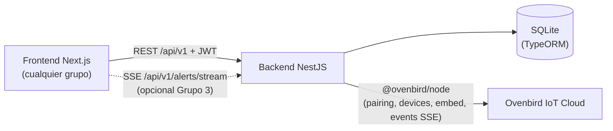

# Backend NestJS — Sistema IoT de Seguimiento de Mascotas (Grupo 3: Pérdida de enlace y zonas)

Backend desarrollado en **NestJS + TypeORM (SQLite)** para el TP Final de IoT. Implementa:
- **Interfaz 2 completa (Contrato REST `/api/v1`)** interoperable con el Frontend de cualquier grupo (14 rutas comunes, errores RFC 9457, `ValidationPipe` tolerante, Swagger en `/api/docs` y `/api/docs-json`).
- **Variante Grupo 3 (`link-loss-zones` — Agurto):** zonas seguras circulares (geocercas), monitoreo en tiempo real sobre eventos de **Ovenbird IoT Cloud** (`@ovenbird/node`) y alertas de salida de zona y pérdida de enlace sin falsas alarmas.

---

## Arquitectura del Backend



### Módulos
- `src/auth`: registro, login, perfil (`/auth/me`), hashing de contraseñas con `bcryptjs`, JWT con Passport (`JwtAuthGuard`).
- `src/pets`: CRUD paginado de mascotas con aislamiento estricto por usuario (`404 PET_NOT_FOUND` para recursos ajenos) y desvinculación automática al borrar.
- `src/devices`: generación de códigos de emparejamiento (`ob.pairing.createCode`), listado filtrado por usuario y ventana de 10 minutos (`GET /devices`), vínculo/desvínculo mascota–collar y emisión de tokens de embebido (`ob.embed.createToken`).
- `src/capabilities`: expone `GET /api/v1/capabilities` con `{ apiVersion: "1", variants: ["link-loss-zones"] }`.
- `src/zones`: CRUD de zonas seguras circulares, motor de evaluación geodésica (**Haversine**), detección de pérdida de enlace, historial de alertas, reconocimiento y stream **SSE**.
- `src/common`: filtro global **RFC 9457** (`application/problem+json`) con traducción de errores del SDK `@ovenbird/node` y `ValidationPipe` tolerante.

---

## Cómo instalar y ejecutar en local

### Requisitos
- **Node.js 20+** (probado en Node 24) y **npm**.

### 1. Instalar dependencias
```bash
npm install
```
> **Nota para Windows con certificados HTTPS corporativos/locales:** si `npm install` o las llamadas a Ovenbird fallan por certificado TLS en Node 24, ejecutá con `NODE_OPTIONS=--use-system-ca`:
> ```powershell
> $env:NODE_OPTIONS='--use-system-ca'
> npm install
> ```

### 2. Configurar variables de entorno
Copiá `.env.example` a `.env` y completá tus credenciales de Ovenbird IoT Cloud (nunca subas `.env` al repositorio):

```bash
cp .env.example .env
```

| Variable | Descripción | Valor por defecto |
| --- | --- | --- |
| `PORT` | Puerto HTTP del backend | `3001` |
| `DATABASE_PATH` | Ruta al archivo SQLite (se crea automáticamente) | `./data/iot-pets.db` |
| `JWT_SECRET` | Clave secreta para firmar JWT (usar una clave larga en producción) | — |
| `JWT_EXPIRES_IN_SECONDS` | Duración del token JWT en segundos | `86400` (24 h) |
| `OVENBIRD_URL` | URL base de Ovenbird IoT Cloud | `https://iotplatform.ovenbirdconsulting.com.ar` |
| `OVENBIRD_CLIENT_ID` | Client ID de integrador del grupo (solo backend) | — |
| `OVENBIRD_CLIENT_SECRET` | Client Secret del grupo (**nunca** exponer en frontend ni repo) | — |
| `OVENBIRD_EVENTS_ENABLED` | Activa la suscripción SSE en vivo a Ovenbird (`true`/`false`) | `true` |
| `ZONE_CONSECUTIVE_OUTSIDE_READINGS` | Lecturas seguidas fuera de zona antes de disparar `ZONE_EXIT` | `2` |
| `ZONE_HYSTERESIS_RATIO` | Margen interior (0..0.5) para resolver `ZONE_EXIT` sin rebote | `0.1` (10%) |
| `LINK_LOSS_GRACE_SECONDS` | Segundos de gracia ante `device.offline` (microcortes de red/app) | `30` |

### 3. Levantar el servidor
```bash
# Desarrollo (recarga automática)
npm run start:dev

# Producción
npm run build
npm run start:prod
```
- API REST: `http://localhost:3001/api/v1`
- Swagger UI: `http://localhost:3001/api/docs`
- OpenAPI JSON: `http://localhost:3001/api/docs-json`

> La base de datos SQLite (`./data/iot-pets.db`) y sus tablas (`users`, `pets`, `pairing_sessions`, `safe_zones`, `alerts`) se crean automáticamente al iniciar el servidor mediante TypeORM.

### 4. Ejecutar pruebas automatizadas (Jest)
```bash
# Pruebas unitarias puras (todas las dependencias reemplazadas por dobles/mocks)
npm test

# Pruebas de integración / E2E HTTP (SQLite en memoria + SDK simulado)
npm run test:e2e
```
- `npm test` ejecuta las pruebas unitarias de `AuthService`, `PetsService`, `DevicesService`, `ZonesService`, `MonitoringService`, `ProblemExceptionFilter` y `validateEnv` (con dobles, sin tocar disco ni base real).
- `npm run test:e2e` levanta la app HTTP en memoria para validar rutas, `PATCH` parcial sin pisar campos omitidos, `404` RFC 9457, `Swagger /api/docs-json` y flujo completo.

---

## Endpoints de la API

### Base común (Interfaz 2 — 14 rutas obligatorias)
| Método | Ruta | Auth | Descripción |
| --- | --- | :---: | --- |
| `POST` | `/api/v1/auth/register` | Pública | Registro de usuario (`201`) |
| `POST` | `/api/v1/auth/login` | Pública | Inicio de sesión (`200`) |
| `GET` | `/api/v1/auth/me` | Bearer | Perfil del usuario actual |
| `GET` | `/api/v1/pets` | Bearer | Listado paginado de mascotas |
| `POST` | `/api/v1/pets` | Bearer | Alta de mascota (`201`) |
| `GET` | `/api/v1/pets/:petId` | Bearer | Detalle de mascota |
| `PATCH` | `/api/v1/pets/:petId` | Bearer | Edición parcial |
| `DELETE` | `/api/v1/pets/:petId` | Bearer | Baja (desvincula collar si tenía) |
| `POST` | `/api/v1/pairing-codes` | Bearer | Código de emparejamiento (10 min) |
| `GET` | `/api/v1/devices` | Bearer | Dispositivos del usuario + recién emparejados |
| `PUT` | `/api/v1/pets/:petId/device` | Bearer | Vincular collar (idempotente) |
| `DELETE` | `/api/v1/pets/:petId/device` | Bearer | Desvincular collar |
| `POST` | `/api/v1/embed-token` | Bearer | Token corto para `@ovenbird/react` (`200`) |
| `GET` | `/api/v1/capabilities` | Pública | `{ apiVersion: "1", variants: ["link-loss-zones"] }` |
| `GET` | `/api/v1/health` | Pública | Health check del servidor (`{ status: "ok", timestamp }`) |

### Variante Grupo 3 (`x-variant: link-loss-zones`)
| Método | Ruta | Auth | Descripción |
| --- | --- | :---: | --- |
| `GET` | `/api/v1/zones` | Bearer | Todas las zonas del usuario (filtro `?petId=`, paginado) |
| `GET` | `/api/v1/pets/:petId/zones` | Bearer | Zonas circulares de una mascota |
| `POST` | `/api/v1/pets/:petId/zones` | Bearer | Crear zona circular (`name`, `centerLat`, `centerLon`, `radiusMeters`, `active?`) |
| `PATCH` | `/api/v1/zones/:zoneId` | Bearer | Editar zona circular |
| `DELETE` | `/api/v1/zones/:zoneId` | Bearer | Eliminar zona (`204`) |
| `GET` | `/api/v1/alerts` | Bearer | Historial paginado de alertas (`?status=active\|resolved&type=ZONE_EXIT\|LINK_LOSS&petId=`) |
| `POST` | `/api/v1/alerts/:alertId/acknowledge` | Bearer | Marcar alerta como vista (`200`) |
| `GET` | `/api/v1/pets/:petId/monitoring` | Bearer | Estado actual: enlace, última ubicación, distancia a cada zona y alertas activas |
| `GET` | `/api/v1/alerts/stream` | Bearer | Stream SSE en vivo (`alert.created`, `alert.resolved`, `monitoring.updated`) |

> **Nota para el Frontend sobre SSE:** conectarse a `/api/v1/alerts/stream` enviando el header `Authorization: Bearer <token>` (por ejemplo con `fetch` o `@microsoft/fetch-event-source`), nunca en query string.

---

## Decisiones de diseño y Requisitos No Funcionales (Sección 4 del TP)

- **Seguridad y aislamiento:** contraseñas hasheadas con `bcryptjs` (salt 10), JWT validado en servidor, validación *fail-fast* de variables obligatorias al iniciar (`JWT_SECRET`, `OVENBIRD_CLIENT_ID`, `OVENBIRD_CLIENT_SECRET`, sin valores de respaldo hardcodeados), IDs UUID no predecibles, `404` ante recursos ajenos para evitar enumeración, `OVENBIRD_CLIENT_SECRET` exclusivamente en backend y fuera de Git (`.env` en `.gitignore`).
- **Confiabilidad de los datos y anti-falsas alarmas:**
  - Se descartan lecturas GPS con `fix === "none"` o coordenadas fuera de rango.
  - **Zonas múltiples:** una mascota se considera segura si está dentro de **al menos una** de sus zonas activas (ej. "Casa" o "Plaza").
  - **Debounce + Histéresis en zonas:** requiere `2` lecturas consecutivas fuera de todas las zonas activas para disparar `ZONE_EXIT` (filtrando saltos aislados de GPS) y exige reingresar al `90%` del radio (`10%` de histéresis) para resolver la alerta sin parpadeos en el borde.
  - **Pérdida de enlace sin falsas alarmas:** dispara `LINK_LOSS` inmediato ante `collar_online = false` (porque la unidad ESP32 ya filtró cortes cortos con `T_offline = max(2×I + 30s, 60s)`), y aplica una ventana de gracia configurable de `30 s` ante `device.offline` (microcortes del puente/app móvil).
- **Recuperación y manejo de errores:** `@ovenbird/node` reintenta automáticamente fallos de red/5xx/429 y reconecta el SSE con `Last-Event-ID`. Todos los errores (incluidos endpoints faltantes `404` y errores del SDK) se devuelven en formato **RFC 9457** sin exponer stack traces ni secretos.
- **Interoperabilidad:** `ValidationPipe` con `forbidNonWhitelisted: false`, `CORS` abierto, prefijo `/api/v1`, Swagger con `x-variant: link-loss-zones` y `GET /api/v1/capabilities`.
